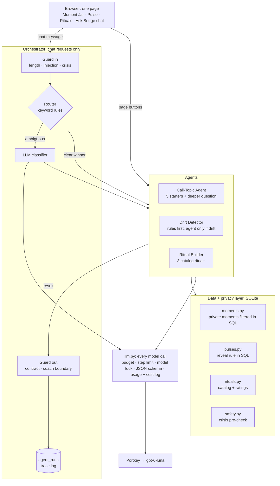
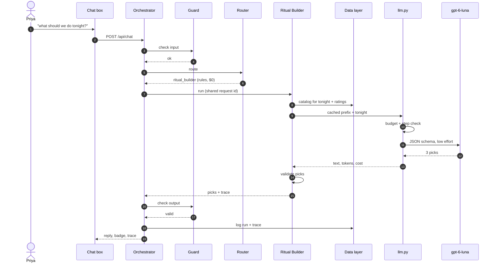

# Bridge: architecture

Bridge is a FastAPI app with a single-page frontend and a SQLite database. Four AI components
(three agents and a router's classifier) all call gpt-6-luna through one wrapper, `app/llm.py`,
which enforces the token budget, step limit, and model lock, and logs every call's tokens and
cost. Privacy rules live in the data layer's SQL, so no agent can read what it shouldn't.

## System

## One chat request, end to end

"What should we do tonight?": the guard passes it, the keyword rules route it (no model call), the
Ritual Builder makes the one model call, its picks are validated, the guard checks the output,
and the whole run is logged.

## The agents

| Component | Called when | Gets | Returns | Checked by code |
|---|---|---|---|---|
| Router classifier | Chat message where keyword rules tie or miss | The message, escaped and tagged | One of 3 intents or `none` (strict enum) | Anything outside the enum means "ask the user" |
| Call-Topic Agent | "Prep for our call", or chat | Shared moments from the last 7 days, couple profile | 5 starters + 1 deeper question, each citing moment ids | Cited ids are shared + in window; no private text; one retry |
| Drift Detector | Pulse page, or chat | Rule-computed signals, shared notes, ritual ratings (agent only if a rule flags drift) | One suggestion + explanation | Coach boundary, numbers from signals only, real flag keys; retry, then rule-based fallback |
| Ritual Builder | Rituals page, or chat | Catalog (filtered to tonight in code), highest/lowest-rated rituals | 3 catalog rituals with why, first step, variation | Ids in catalog + fit tonight; no invented bookings/purchases; real ratings only; retry, then rule picks |

All four use gpt-6-luna through Portkey with reasoning effort `low` (measured: same quality,
about a third of the cost, see `docs/evals/`). Each agent's prompt puts the stable part first
(rules, catalog, couple profile), so later calls read it from the prompt cache.

## Safety layers and where they live

| Defense | Code | Test |
|---|---|---|
| Prompt injection: user text escaped and tagged as data | `app/prompting.py` | `tests/test_prompt_injection.py`, `tests/test_call_topics.py` |
| Prompt injection: chat messages screened before routing | `app/guard.py` | `tests/test_orchestrator.py` |
| Privacy: private moments, the pulse reveal rule, only the privacy layer reads those tables | `app/moments.py`, `app/pulses.py` | `tests/test_moments_privacy.py`, `tests/test_pulse.py` |
| No invented facts: citations must be real, numbers and ratings must come from the data | each agent's `validate()` | `tests/test_call_topics.py`, `tests/test_pulse.py`, `tests/test_rituals.py` |
| Coach boundary: crisis pre-check before any coaching, relationship-decision requests get a counselor referral, boundary phrases blocked in output (and withheld from traces) | `app/safety.py`, `app/guard.py`, `app/agents/drift.py` | `tests/test_pulse.py`, `tests/test_orchestrator.py`, `tests/test_safety.py` |
| Per-user daily token budget (Portkey cache hits are free) | `app/llm.py` | `tests/test_llm.py` |
| Step limit per request (shared by router + agent) | `app/llm.py`, `app/orchestrator.py` | `tests/test_llm.py`, `tests/test_orchestrator.py` |
| Model lock: only gpt-6-luna, checked on every response | `app/llm.py` | `tests/test_llm.py` |

All seven attack/malfunction scenarios run end to end with readable output:
`python scripts/run_safety_demo.py` (and `--live` for the real model); `tests/test_safety.py`
asserts the same scenarios.
